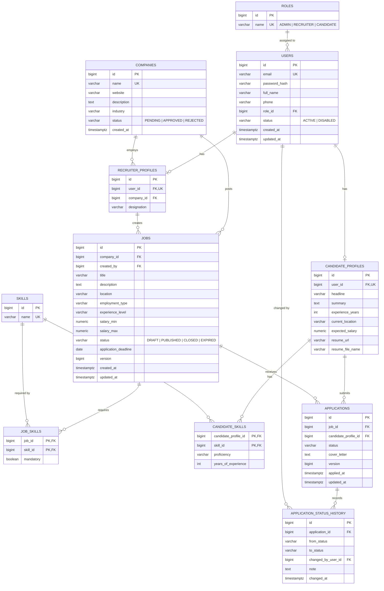

# HireHub — Database Design

> Status: **implemented** as of Phase 2A. The schema described here is created by
> `src/main/resources/db/migration/V1__init_schema.sql` and seeded by
> `V2__seed_reference_data.sql`, and mapped by the JPA entities added in Phase 2B.

---

## 1. Why PostgreSQL?

**What:** PostgreSQL 16 as the single source of truth.

**Why:** the domain is inherently relational. A job belongs to a company, an application
joins a candidate and a job, a status history is a child of an application. These are
foreign-key relationships with strong integrity requirements — a candidate must never have
an application pointing at a deleted job. PostgreSQL also gives us: `CHECK` constraints,
partial and composite indexes, `ILIKE`/trigram search, window functions for statistics, and
true ACID transactions for the multi-table application workflow.

**Alternative:** MongoDB. Rejected: duplicate-application prevention across two entities, a
status-history audit trail, and multi-filter search with joins are all things a document
store makes harder, not easier. MySQL would also work; PostgreSQL wins on constraint support,
index types (GIN/partial) and enum handling.

---

## 2. ER diagram



---

## 3. Relationship catalogue

| Relationship | Cardinality | Implementation | Why |
|---|---|---|---|
| `users` → `roles` | many-to-one | `users.role_id` FK, NOT NULL | Exactly one role per user in this system. A lookup table (rather than a raw enum column) keeps role names in one place and lets an admin UI list roles without redeploying. **Alternative:** `user_roles` join table for multi-role users — rejected as unnecessary for three mutually exclusive roles, but the FK design makes that migration easy. |
| `users` → `candidate_profiles` | one-to-one | `candidate_profiles.user_id` FK + **UNIQUE** | The UNIQUE constraint is what makes it one-to-one rather than one-to-many. Profile data is split from `users` so authentication reads stay narrow. |
| `users` → `recruiter_profiles` | one-to-one | same pattern | |
| `companies` → `recruiter_profiles` | one-to-many | `recruiter_profiles.company_id` FK | Several recruiters can work for one company. |
| `companies` → `jobs` | one-to-many | `jobs.company_id` FK NOT NULL | A job cannot exist without a company. |
| `jobs` ↔ `skills` | many-to-many | `job_skills` join table, composite PK | Extra column `mandatory` — a reason to model the join explicitly as an entity rather than with `@ManyToMany`. |
| `candidate_profiles` ↔ `skills` | many-to-many | `candidate_skills`, composite PK | Extra columns `proficiency`, `years_of_experience`. |
| `candidates` ↔ `jobs` | many-to-many **with payload** | `applications` | The relationship *is* the entity: it has status, timestamps and children. |
| `applications` → `application_status_history` | one-to-many | `application_status_history.application_id` FK | Append-only audit trail. |

### Why join tables instead of `@ManyToMany`

`@ManyToMany` hides the join table and cannot carry extra columns. Both of our many-to-many
relations need payload columns, so each is modelled as a first-class entity with a composite
key (`@EmbeddedId`) and two `@ManyToOne` associations. This is the standard production
pattern and avoids the well-known `@ManyToMany` delete/re-insert behaviour.

---

## 4. Normalisation

The schema is in **3NF**:

- **1NF** — no repeating groups: skills live in `skills`, not a comma-separated column.
- **2NF** — in `candidate_skills`, `proficiency` depends on the whole composite key
  (candidate + skill), not on either half.
- **3NF** — no transitive dependencies: `jobs` stores `company_id`, not the company name and
  website. Company details are read through the FK.

**Deliberate denormalisation:** none in the core schema. If application-count-per-job becomes
a hot read, a maintained counter column is the first candidate — but only with measurements
to justify it. Premature denormalisation is how audit trails start lying.

---

## 5. Constraints

| Type | Examples | Purpose |
|---|---|---|
| PRIMARY KEY | every table; `BIGSERIAL`/identity surrogate keys | Stable identity independent of business data (emails change; PKs must not). |
| FOREIGN KEY | `jobs.company_id`, `applications.job_id`, … | Referential integrity — the DB refuses to create an orphan. |
| UNIQUE | `users.email`, `companies.name`, `skills.name`, `(job_id, candidate_profile_id)` on `applications`, `user_id` on both profile tables | The only concurrency-safe way to enforce "at most one". |
| NOT NULL | `users.email`, `password_hash`, `role_id`, `jobs.title`, `jobs.status`, `applications.status` | Prevents half-built rows. |
| CHECK | `salary_max >= salary_min`; `experience_years >= 0`; `salary_min >= 0` | Business invariants that must hold regardless of which code path writes the row. |
| DEFAULT | `created_at = now()`, `status = 'DRAFT'` | Sane values when a column is omitted. |

**Enums as `VARCHAR` + CHECK, not native PostgreSQL `ENUM` types.** Mapped in JPA with
`@Enumerated(EnumType.STRING)`. Why: adding a value to a native PG enum requires a DDL
migration and behaves awkwardly inside transactions; `VARCHAR` keeps the data readable in raw
SQL and lets Hibernate validate the values. `EnumType.ORDINAL` is never used — inserting a new
constant in the middle of an enum would silently corrupt every existing row.

---

## 6. Indexes — and why each one exists

> Phase 9 update: `idx_jobs_location` and `idx_jobs_title_trgm` are now both exercised by
> real query predicates in `JobSpecifications` (`hasLocation`, `hasKeyword`), written to
> match each index's exact expression — `lower(location) = ?` and `title ILIKE '%...%'`
> respectively, not a look-alike expression the index can't actually serve. See that class's
> Javadoc for why the distinction matters and `JobSpecificationsTest` for the tests proving
> both filters behave correctly against real PostgreSQL.

An index speeds up reads and slows down writes (every insert/update maintains it), so each
one below is justified by a specific query the application actually runs.

| Index | Column(s) | Justified by |
|---|---|---|
| `uq_users_email` | `users(email)` UNIQUE | Every login does `WHERE email = ?`. The UNIQUE constraint creates the index, so it enforces correctness *and* serves the hottest auth query. |
| `idx_jobs_status_created_at` | `jobs(status, created_at DESC)` | The default job feed is `WHERE status='PUBLISHED' ORDER BY created_at DESC LIMIT 10`. A **composite** index in this order filters and supplies the sort order in one pass — no separate sort step. Column order matters: the equality predicate comes first, the range/sort column second. |
| `idx_jobs_location` | `jobs(lower(location))` | Location is the most-used filter. A **functional** index on `lower(location)` matches the case-insensitive comparison the query uses; a plain index on `location` would be ignored by `lower(location) = ?`. |
| `idx_jobs_title_trgm` | GIN trigram on `jobs(title)` | Keyword search uses `title ILIKE '%java%'`. A B-tree cannot serve a leading wildcard; `pg_trgm` + GIN can. Full-text search (`tsvector`) is the next step if partial-word matching stops being enough. |
| `idx_jobs_company_id` | `jobs(company_id)` | "All jobs by my company" on the recruiter dashboard. PostgreSQL does **not** auto-index FK columns, only the referenced PK — this must be created explicitly. |
| `uq_applications_job_candidate` | `applications(job_id, candidate_profile_id)` UNIQUE | Enforces "one application per candidate per job" under concurrency, and serves the "have I applied?" lookup for free. |
| `idx_applications_candidate_status` | `applications(candidate_profile_id, status)` | "My applications, filtered by status" — the candidate dashboard. |
| `idx_applications_job_status` | `applications(job_id, status)` | "Applicants for job X who are SHORTLISTED" — the recruiter pipeline view. |
| `idx_app_status_history_application` | `application_status_history(application_id, changed_at)` | Renders one application's timeline in chronological order. |

**Not indexed, deliberately:** `jobs.description` (large text, never filtered on exactly),
`users.full_name` (not a search entry point), `jobs.salary_min`/`salary_max` (low selectivity
— a range scan over an already-filtered result set is cheaper than maintaining the index),
and every boolean-ish column. Indexing every column is a classic anti-pattern: it inflates
write cost and storage while the planner ignores most of them.

**Verification:** each index above is checked with `EXPLAIN ANALYZE` on seeded data during
Phase 9; an index the planner never picks gets deleted.

---

## 7. Transactions

> Phase 10 update: both rows below are now implemented, using exactly the method names
> predicted in Phase 0. `ApplicationService.withdraw()` follows the same
> commit-status-and-history-together shape as `updateStatus()` and isn't listed separately
> for that reason — it calls the identical `Application.changeStatus()` entity method.

| Operation | Boundary | Why it must be atomic |
|---|---|---|
| Apply to a job | `ApplicationService.apply()` | Inserts the `applications` row **and** its first `application_status_history` row. A committed application with no history would break the audit trail. |
| Change application status | `ApplicationService.updateStatus()` | Updates `applications.status` and appends a history row. Partial success would make the history contradict the current state. |
| Approve a company | `CompanyService.decide()` | Flips `companies.status`. Will extend to activate the recruiter's pending jobs once jobs exist (Phase 8) — implemented now exactly at the boundary this row already described in Phase 0, so that extension is additive rather than a rewrite. |
| Register a user | `AuthService.register()` | Inserts `users` plus the matching profile row. A user without a profile is unusable. |

Read-only queries are annotated `@Transactional(readOnly = true)`, which lets Hibernate skip
dirty-checking and allows routing to a read replica later. `@Transactional` is **not** applied
blindly to every method: a single-statement read gains nothing from it, and annotating
everything hides where the real boundaries are.

**Propagation:** default `REQUIRED` throughout — a service method called from another service
joins the existing transaction rather than opening a second one. Note that Spring's proxy-based
`@Transactional` does not apply to self-invocation inside the same bean; where that matters,
the work is moved to a separate bean instead of using `AopContext` tricks.

---

## 8. Schema management

**Flyway owns the schema; Hibernate only checks it.**

```
src/main/resources/db/migration/
├── V1__init_schema.sql          tables, constraints, indexes
└── V2__seed_reference_data.sql  roles + starter skill vocabulary
```

- `spring.jpa.hibernate.ddl-auto: validate` — never `update` or `create-drop`. `update`
  never drops or alters anything safely, silently diverges between environments, and gives
  no migration history. `validate` fails startup the moment an entity stops matching the
  schema, which turns a subtle runtime error into a loud boot failure.
- Migrations are **immutable once merged**. A mistake is fixed by adding `V3`, never by
  editing `V1` — Flyway checksums applied migrations and refuses to run against a
  modified history.
- `baseline-on-migrate: false`, so Flyway refuses to silently adopt a non-empty database
  it did not create.
- Reference data (roles) lives in a migration because registration depends on it. Demo
  fixtures deliberately do not, since migrations also run in production.
- `updated_at` has a database default for inserts, but is maintained by JPA auditing
  (`@LastModifiedDate`) on updates rather than by a trigger — one place to reason about,
  and it keeps the entity and the row in agreement within a transaction.

**Verification.** `SchemaMigrationTest` boots against a real PostgreSQL container and
asserts that every table exists, that the roles are seeded, that the search indexes were
created, and that `uq_applications_job_candidate` and the skill CHECK constraint actually
reject bad writes. A constraint that is documented but not enforced is worse than no
constraint at all.
