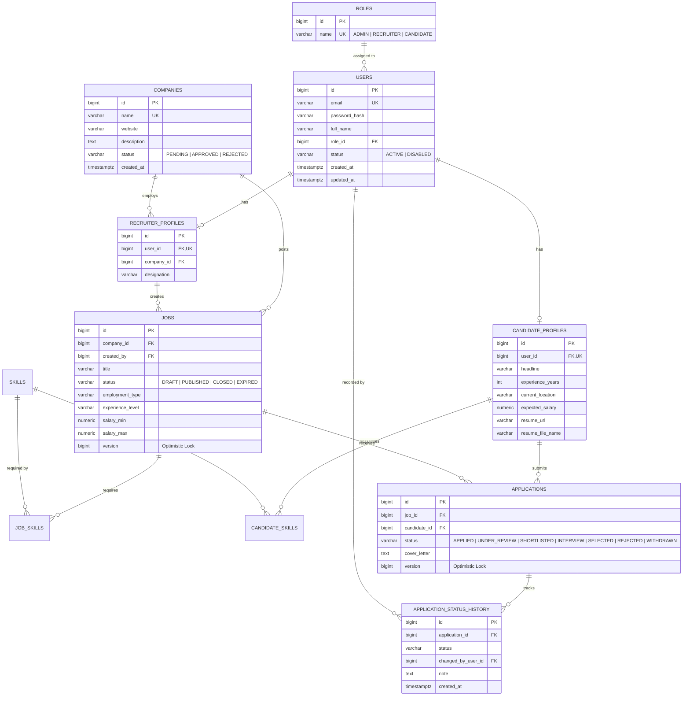

# HireHub — Full-Stack Recruitment Management System & ATS

[](https://openjdk.org/)
[](https://spring.io/projects/spring-boot)
[](https://www.postgresql.org/)
[](https://react.dev/)
[](https://vitejs.dev/)
[](https://www.docker.com/)
[](https://github.com/features/actions)
[](LICENSE)

HireHub is a production-grade, full-stack recruitment platform and Applicant Tracking System (ATS). Built as a high-performance layered monolith with a Java 21 / Spring Boot 3 backend, a modern React 19 single-page application (SPA), and PostgreSQL 16, HireHub replaces scattered email threads and spreadsheets with a single relational system of record, explicit status state machines, and an immutable audit trail.

---

## Table of Contents

1. [Project Overview](#1-project-overview)
2. [Key Capabilities & Role Workflows](#2-key-capabilities--role-workflows)
3. [System Architecture](#3-system-architecture)
4. [Technology Stack](#4-technology-stack)
5. [Database Architecture & ERD](#5-database-architecture--erd)
6. [Complete REST API Reference](#6-complete-rest-api-reference)
7. [State Machines & Business Invariants](#7-state-machines--business-invariants)
8. [Setup & Quick Start](#8-setup--quick-start)
   - [Method 1: Full-Stack Docker Compose (Recommended)](#method-1-full-stack-docker-compose-recommended)
   - [Method 2: Local Development Setup](#method-2-local-development-setup)
   - [Admin Account Provisioning](#admin-account-provisioning)
9. [Configuration & Environment Variables](#9-configuration--environment-variables)
10. [Testing & Quality Assurance](#10-testing--quality-assurance)
11. [Project Directory Structure](#11-project-directory-structure)
12. [CI/CD Pipeline](#12-cicd-pipeline)
13. [License](#13-license)

---

## 1. Project Overview

### The Problem
Traditional hiring workflows rely on disparate email chains, unmanaged spreadsheets, and disconnected platforms:
- **Candidates** submit applications into a void with zero transparency on review stages or decision timelines.
- **Recruiters & Hiring Teams** struggle with tracking candidate progression, evaluating skill overlaps, and preventing duplicate submissions.
- **Enterprises** lack immutable audit trails to verify who approved, rejected, or moved a candidate and when.

### The Solution
HireHub provides a unified, role-based platform enforcing:
- **Strict Role-Based Workflows**: Tailored portals for Candidates, Recruiters, and Admins.
- **Explicit State Machines**: Deterministic transitions for both Job Postings and Candidate Application Pipelines.
- **Immutable Status Auditing**: Every stage update produces an append-only historical audit record.
- **Real-Time Communication**: Server-Sent Events (SSE) deliver live notifications for pipeline and application updates.
- **Resume Management**: Native PDF resume upload, isolated storage, and in-browser preview stream.

---

## 2. Key Capabilities & Role Workflows

### 👤 Candidate Portal
- **Authentication & Security**: Self-registration with email/password, stateless JWT authentication.
- **Rich Profile Management**: Editable professional summary, headline, years of experience, current location, and salary expectations.
- **Skills Portfolio**: Tag skills with standardized proficiency levels (`BEGINNER`, `INTERMEDIATE`, `ADVANCED`, `EXPERT`) and verified years of experience.
- **Resume Handling**: Upload, preview, download, and delete PDF resumes with strict MIME validation.
- **Smart Job Search**: Filter published jobs by keyword (trigram matching), location, employment type, experience level, salary range, and required skills with sorting and pagination.
- **One-Click Application**: Apply with tailored cover letters and track live pipeline progress (`APPLIED` → `UNDER_REVIEW` → `SHORTLISTED` → `INTERVIEW` → `SELECTED` / `REJECTED`).
- **Application Self-Withdrawal**: Withdraw active applications at any point before a final decision.
- **Real-Time Alerts**: Receive instant SSE notifications when an application status changes.

### 🏢 Recruiter & Company Workspace
- **Company Profile Creation**: Create corporate profiles (`PENDING` admin approval) with description, industry, and website.
- **Team-Wide Collaboration**: Company-wide ownership model allowing team recruiters to manage joint job requisitions and candidate pools.
- **Job Lifecycle Management**: Draft, update, publish (requires approved company), close, or delete job requisitions.
- **Mandatory & Preferred Skill Criteria**: Attach specific skills to job posts with mandatory flags.
- **Applicant Pipeline & Review**: Review applicant profiles, inspect submitted resumes, filter applicants by stage, and transition candidate status with optional review notes.
- **Recruiter Analytics**: Live hiring funnel metrics, application status breakdowns, and pipeline distribution charts.

### 🛡️ Admin Moderation
- **Company Moderation**: Review pending company registrations and issue single-transition `APPROVED` or `REJECTED` decisions.
- **System Monitoring**: Access Actuator metrics, health indicators, and platform statistics.
- **Privileged Access**: Guarded under `/api/admin/**` at the security filter level; `ADMIN` accounts cannot be self-registered via public endpoints.

---

## 3. System Architecture

HireHub is designed as a secure, high-performance layered architecture with strict boundary enforcement:

```
┌─────────────────────────────────────────────────────────────────────────┐
│                           Client Tier                                   │
│  React 19 SPA (Vite 8, Lucide React)  │  Swagger UI  │  cURL / Postman   │
└────────────────────────────────────┬────────────────────────────────────┘
                                     │ HTTP/JSON + SSE
                                     ▼
┌─────────────────────────────────────────────────────────────────────────┐
│                         Reverse Proxy (Docker)                          │
│                   Nginx Alpine (Port 3000 -> 8080)                      │
└────────────────────────────────────┬────────────────────────────────────┘
                                     │ Bearer JWT / Multipart Form
                                     ▼
┌─────────────────────────────────────────────────────────────────────────┐
│                     Spring Boot 3.5 API Tier (Port 8080)                │
│                                                                         │
│  ┌───────────────────────────────────────────────────────────────────┐  │
│  │ Security Filter Chain                                             │  │
│  │ CorsFilter ──► JwtAuthenticationFilter ──► Role & Method Security │  │
│  └─────────────────────────────────┬─────────────────────────────────┘  │
│                                    ▼                                    │
│  ┌───────────────────────────────────────────────────────────────────┐  │
│  │ Controller Layer                                                  │  │
│  │ - Pure REST DTO in/out, Bean Validation, OpenAPI annotations      │  │
│  │ - Centralized @RestControllerAdvice exception translation         │  │
│  └─────────────────────────────────┬─────────────────────────────────┘  │
│                                    ▼                                    │
│  ┌───────────────────────────────────────────────────────────────────┐  │
│  │ Service Layer (Business Logic & Transactions)                     │  │
│  │ - Transaction boundaries (@Transactional)                         │  │
│  │ - State machine enforcement, ownership checks, SSE notification   │  │
│  └─────────────────────────────────┬─────────────────────────────────┘  │
│                                    ▼                                    │
│  ┌───────────────────────────────────────────────────────────────────┐  │
│  │ Repository Layer (Spring Data JPA + Specifications)               │  │
│  │ - Batch fetching (default_batch_fetch_size: 25)                   │  │
│  │ - Dynamic JPA Criteria Specifications for search                  │  │
│  │ - @EntityGraph fetch joins to eliminate N+1 queries               │  │
│  └─────────────────────────────────┬─────────────────────────────────┘  │
└────────────────────────────────────┼────────────────────────────────────┘
                                     │ HikariCP JDBC Connection Pool
                                     ▼
┌─────────────────────────────────────────────────────────────────────────┐
│                      Database Tier (PostgreSQL 16)                      │
│  - Flyway versioned migrations (V1 schema, V2 reference seed)           │
│  - pg_trgm extension for GIN indexed fuzzy title search                 │
│  - Foreign key cascades, check constraints, composite unique indexes    │
│  - Volume persistence for database data & uploaded resume files         │
└─────────────────────────────────────────────────────────────────────────┘
```

### Architectural Highlights

- **Stateless JWT Security**: JJWT with HS256 hashing. The security filter validates tokens and re-authorizes users against the database on each request, ensuring instant revocation if an account is disabled or roles change.
- **Elimination of N+1 Queries**: JPA lazy-loading pitfalls are prevented with explicit `@EntityGraph` attribute paths and Hibernate `default_batch_fetch_size: 25`.
- **Concurrency & Race Condition Defenses**:
  - Entity-level optimistic locking via `@Version` prevents lost updates in concurrent status changes.
  - Two-layer duplicate protection: friendly application-level checks plus database-level `UNIQUE` constraints that hold under concurrent races.
- **Clean DTO Boundaries**: Entities are never exposed through controllers; records and typed DTOs handle all ingress and egress.

---

## 4. Technology Stack

| Layer | Technology | Details |
|---|---|---|
| **Language** | Java 21 LTS | Modern Java features (Records, Pattern Matching, Virtual Thread compatibility) |
| **Framework** | Spring Boot 3.5.5 | Spring Web, Spring Security, Spring Data JPA, Bean Validation, Actuator |
| **Database** | PostgreSQL 16 | ACID transactions, `pg_trgm` GIN index, CHECK constraints, UTC Timestamps |
| **Schema Migrations** | Flyway 10 | Versioned, immutable SQL migrations (`V1`, `V2`), `ddl-auto: validate` |
| **Authentication** | Spring Security + JJWT 0.12.6 | Stateless JWT bearer tokens, BCrypt password hashing |
| **Real-Time Stream** | Spring Web MVC SseEmitter | Server-Sent Events (SSE) for low-overhead browser notifications |
| **Frontend SPA** | React 19.2 + Vite 8.3 | Ultra-fast build, functional hooks, Lucide icons, responsive layout |
| **Web Server / Proxy** | Nginx Alpine | Serves production React build, proxies `/api` and `/api/notifications/stream` |
| **API Documentation** | springdoc-openapi 2.8 | Interactive Swagger UI, OpenAPI v3 spec generation |
| **Testing** | JUnit 5, Mockito, Testcontainers | MockMvc integration tests, PostgreSQL Testcontainer, isolated unit tests |
| **DevOps & Containers** | Docker & Docker Compose | Multi-stage Docker builds, healthchecks, container networks & volumes |
| **CI/CD** | GitHub Actions | Automated build, test, frontend lint/build, and Docker configuration checks |

---

## 5. Database Architecture & ERD

The database schema is managed through Flyway versioned migrations. The entity-relationship model guarantees complete relational integrity across 11 core tables:



### Key Relational Rules & Indexes
- **`uq_applications_job_candidate`**: Enforces strictly one application per candidate per job.
- **`idx_jobs_title_trgm`**: PostgreSQL GIN trigram index over `jobs.title` for high-speed fuzzy keyword searching.
- **`idx_jobs_status_created`**: Composite index for filtering published jobs ordered by creation timestamp.
- **Audit Preservation**: `APPLICATION_STATUS_HISTORY.changed_by_user_id` uses `ON DELETE SET NULL`, preserving the audit history even if an administrative user is removed.

---

## 6. Complete REST API Reference

Base API URL (Local / Docker): `http://localhost:8080/api`  
Interactive Swagger UI: `http://localhost:8080/swagger-ui.html`  
OpenAPI JSON Specification: `http://localhost:8080/v3/api-docs`

### Standard Response Envelopes

**Success Envelope (`ApiResponse<T>`)**
```json
{
  "success": true,
  "message": "Operation completed successfully",
  "data": { ... }
}
```

**Error Envelope (`ErrorResponse`)**
```json
{
  "timestamp": "2026-10-17T12:00:00Z",
  "status": 400,
  "error": "BAD_REQUEST",
  "message": "Validation failed",
  "path": "/api/jobs",
  "fieldErrors": {
    "title": "Title cannot be blank"
  }
}
```

---

### Endpoints Table

#### 1. System Health & Monitoring
| Method | Endpoint | Auth / Role | Description |
|---|---|---|---|
| `GET` | `/api/health` | Public | Service health status, app name, and version |
| `GET` | `/actuator/health` | Public | Spring Boot Actuator subsystem health |

#### 2. Authentication & Identity
| Method | Endpoint | Auth / Role | Description |
|---|---|---|---|
| `POST` | `/api/auth/register` | Public | Register new user as `CANDIDATE` or `RECRUITER` |
| `POST` | `/api/auth/login` | Public | Authenticate credentials and acquire JWT Bearer token |
| `GET` | `/api/auth/me` | Authenticated | Retrieve profile and role of currently authenticated user |

#### 3. Candidate Profile & Resumes
| Method | Endpoint | Auth / Role | Description |
|---|---|---|---|
| `GET` | `/api/candidates/me` | `CANDIDATE` | Fetch candidate profile, skills, and resume metadata |
| `PUT` | `/api/candidates/me` | `CANDIDATE` | Update candidate headline, bio, experience, location, and salary |
| `GET` | `/api/candidates/me/skills` | `CANDIDATE` | List all skills attached to candidate profile |
| `POST` | `/api/candidates/me/skills` | `CANDIDATE` | Add/associate a skill with proficiency level and experience |
| `DELETE` | `/api/candidates/me/skills/{skillId}` | `CANDIDATE` | Remove a skill from candidate profile |
| `POST` | `/api/candidates/me/resume` | `CANDIDATE` | Upload PDF resume (`multipart/form-data`, param: `file`) |
| `DELETE` | `/api/candidates/me/resume` | `CANDIDATE` | Delete uploaded resume from storage |
| `GET` | `/api/candidates/{id}` | `RECRUITER`, `ADMIN` | View detailed candidate profile by candidate ID |
| `GET` | `/api/resumes/{fileName}` | Authenticated | Stream / download candidate resume PDF file |

#### 4. Companies & Recruiters
| Method | Endpoint | Auth / Role | Description |
|---|---|---|---|
| `POST` | `/api/companies` | `RECRUITER` | Register a new company profile (enters `PENDING` state) |
| `GET` | `/api/companies/{id}` | Public | View public company profile and details |
| `PUT` | `/api/companies/{id}` | `RECRUITER` (Owner) | Update company name, description, industry, website |
| `GET` | `/api/recruiters/me` | `RECRUITER` | Retrieve current recruiter's profile and company linkage |
| `PUT` | `/api/recruiters/me` | `RECRUITER` | Update recruiter designation and details |
| `GET` | `/api/recruiters/me/jobs` | `RECRUITER` | List jobs personally created by current recruiter |

#### 5. Job Postings & Search
| Method | Endpoint | Auth / Role | Description |
|---|---|---|---|
| `GET` | `/api/jobs` | Public | Search and paginate published jobs with dynamic filters |
| `GET` | `/api/jobs/{id}` | Public* | Get job by ID (*DRAFT postings visible only to owners & admins) |
| `POST` | `/api/jobs` | `RECRUITER` | Create a job posting for recruiter's company (initial: `DRAFT`) |
| `PUT` | `/api/jobs/{id}` | `RECRUITER` (Owner) | Update job requisition (allowed while `DRAFT` or `PUBLISHED`) |
| `PATCH` | `/api/jobs/{id}/publish` | `RECRUITER` (Owner) | Publish job (requires company status to be `APPROVED`) |
| `PATCH` | `/api/jobs/{id}/close` | `RECRUITER` (Owner) | Close an active job posting |
| `DELETE` | `/api/jobs/{id}` | `RECRUITER` (Owner) | Delete a job posting (permitted only in `DRAFT` state) |

**Supported Search Query Parameters on `GET /api/jobs`:**
- `keyword`: Fuzzy text match against job title using trigrams.
- `location`: Case-insensitive location match.
- `employmentType`: `FULL_TIME`, `PART_TIME`, `CONTRACT`, `INTERNSHIP`, `REMOTE`.
- `experienceLevel`: `ENTRY_LEVEL`, `MID_LEVEL`, `SENIOR_LEVEL`, `LEAD`, `EXECUTIVE`.
- `minSalary` / `maxSalary`: Filter matching jobs within budgetary limits.
- `skill`: Filter jobs requiring a specific skill by name.
- `page`, `size`: Zero-based pagination (e.g. `page=0&size=10`).
- `sort`: Allow-listed sort parameters (`createdAt`, `title`, `salaryMin`, `salaryMax`), e.g., `sort=createdAt,desc`.

#### 6. Job Applications & Pipeline
| Method | Endpoint | Auth / Role | Description |
|---|---|---|---|
| `POST` | `/api/jobs/{jobId}/applications` | `CANDIDATE` | Apply to a published job (requires complete profile) |
| `GET` | `/api/candidates/me/applications` | `CANDIDATE` | List all applications submitted by candidate (`?status=` optional) |
| `GET` | `/api/applications/{id}` | Candidate / Recruiter / Admin | View application details with candidate and job summary |
| `PATCH` | `/api/applications/{id}/withdraw` | `CANDIDATE` (Owner) | Candidate self-withdraws application before final decision |
| `GET` | `/api/jobs/{jobId}/applications` | `RECRUITER` (Company) | List all candidate applications for a specific company job |
| `PATCH` | `/api/applications/{id}/status` | `RECRUITER` (Company) | Transition candidate status along the hiring pipeline |
| `GET` | `/api/applications/{id}/history` | Candidate / Recruiter / Admin | View full chronological status transition audit log |

#### 7. Admin Moderation
| Method | Endpoint | Auth / Role | Description |
|---|---|---|---|
| `GET` | `/api/admin/companies` | `ADMIN` | List company registrations (`?status=PENDING`) |
| `PATCH` | `/api/admin/companies/{id}/approval` | `ADMIN` | Approve or reject pending company registration |

#### 8. Real-Time Notifications
| Method | Endpoint | Auth / Role | Description |
|---|---|---|---|
| `GET` | `/api/notifications/stream` | Authenticated | Live Server-Sent Events (SSE) notification stream |
| `GET` | `/api/notifications/recent` | Authenticated | Retrieve recent notification history for user |

---

## 7. State Machines & Business Invariants

### 1. Job Requisition Lifecycle

```
  ┌───────────┐         publish()          ┌─────────────┐
  │   DRAFT   ├───────────────────────────►│  PUBLISHED  │
  └─────┬─────┘                            └──────┬──────┘
        │                                         │
        │ delete()                                │ close() / expire()
        ▼                                         ▼
  ┌───────────┐                            ┌─────────────┐
  │  DELETED  │                            │   CLOSED    │
  └───────────┘                            └─────────────┘
```
- A job starts in `DRAFT`.
- A job can only transition to `PUBLISHED` if the recruiter's company is in `APPROVED` status.
- Once a job is `CLOSED` or `EXPIRED`, it cannot be reopened or edited.
- A job can only be deleted while in `DRAFT` status; once published, it must be closed.

### 2. Candidate Application Pipeline

```
  ┌───────────┐         review()           ┌──────────────┐
  │  APPLIED  ├───────────────────────────►│ UNDER_REVIEW │
  └─────┬─────┘                            └──────┬───────┘
        │                                         │ shortlist()
        │                                         ▼
        │                                  ┌──────────────┐
        │                                  │ SHORTLISTED  │
        │                                  └──────┬───────┘
        │                                         │ interview()
        │                                         ▼
        │                                  ┌──────────────┐
        │                                  │  INTERVIEW   │
        │                                  └──────┬───────┘
        │                                         │ select()
        │                                         ▼
        │                                  ┌──────────────┐
        │                                  │   SELECTED   │
        │                                  └──────────────┘
        │
        ├────────────────────────────────► ┌──────────────┐
        │       reject() (at any stage)    │   REJECTED   │
        │                                  └──────────────┘
        │
        └────────────────────────────────► ┌──────────────┐
                withdraw() (candidate)     │  WITHDRAWN   │
                                           └──────────────┘
```
- **Forward Progression**: Applications strictly move forward stage-by-stage. Stage skipping (e.g. jumping from `APPLIED` straight to `SELECTED`) is prohibited.
- **Terminal States**: `SELECTED`, `REJECTED`, and `WITHDRAWN` are terminal. No further status changes are permitted once reached.
- **Permissions Separation**: Only candidates can mark an application as `WITHDRAWN`. Only authorized company recruiters or admins can move an application through review, interview, selection, or rejection.

---

## 8. Setup & Quick Start

### Prerequisites
- [Docker](https://docs.docker.com/get-docker/) & [Docker Compose](https://docs.docker.com/compose/) (v2.0+)  
*or for manual local development:*
- Java 21 JDK ([Eclipse Temurin recommended](https://adoptium.net/))
- Maven 3.9+
- Node.js 20+ & npm
- PostgreSQL 16 local server

---

### Method 1: Full-Stack Docker Compose (Recommended)

Run the entire platform (PostgreSQL, Spring Boot Backend API, React Frontend with Nginx) with a single command:

```bash
# 1. Clone repository
git clone https://github.com/<your-username>/hirehub.git
cd hirehub

# 2. Build and launch all containers
docker compose up --build -d

# 3. View service logs
docker compose logs -f
```

#### Access Points:
- 🌐 **Frontend Application**: `http://localhost:3000`
- ⚙️ **Backend REST API**: `http://localhost:8080/api`
- 📚 **Swagger UI Documentation**: `http://localhost:8080/swagger-ui.html`
- 🐘 **PostgreSQL Database**: `localhost:5432` (`hirehub` / `hirehub`)

To shut down the platform:
```bash
docker compose down
```

---

### Method 2: Local Development Setup

#### 1. Setup PostgreSQL Database
Open `psql` or your database GUI and create the application and test databases:

```sql
CREATE ROLE hirehub WITH LOGIN PASSWORD 'hirehub';
CREATE DATABASE hirehub OWNER hirehub;
CREATE DATABASE hirehub_test OWNER hirehub;
```

#### 2. Configure Environment
Copy the environment template:
```bash
cp .env.example .env
```

#### 3. Run Spring Boot Backend
```bash
# Build and run backend (Flyway will automatically migrate schema on startup)
mvn spring-boot:run
```
Verify the API:
```bash
curl http://localhost:8080/api/health
```

#### 4. Run React Frontend
In a new terminal:
```bash
cd frontend
npm install
npm run dev
```
Open `http://localhost:5173` to interact with the Vite development server.

---

### Admin Account Provisioning

By security design, `ADMIN` users cannot be self-registered via the public API. To bootstrap or reset an administrator account:

1. Connect to your PostgreSQL database:
   ```bash
   # In Docker
   docker exec -it hirehub-postgres psql -U hirehub -d hirehub
   # Or locally
   psql -U hirehub -d hirehub
   ```
2. Execute the provided admin provisioning script:
   ```sql
   \i reset_admin_password.sql
   ```
   Or execute directly from your terminal:
   ```bash
   psql -U hirehub -d hirehub -f reset_admin_password.sql
   ```
3. Default administrative credentials will be:
   - **Email**: `admin@hirehub.local`
   - **Password**: `Password123`

---

## 9. Configuration & Environment Variables

All runtime configuration is managed via environment variables.

| Variable | Default Value | Description |
|---|---|---|
| `SPRING_PROFILES_ACTIVE` | `dev` | Active Spring profile (`dev`, `prod`, `test`) |
| `SERVER_PORT` | `8080` | HTTP port exposed by Spring Boot |
| `DB_HOST` | `localhost` (in compose: `postgres`) | Hostname of PostgreSQL database |
| `DB_PORT` | `5432` | PostgreSQL port |
| `DB_NAME` | `hirehub` | Application database name |
| `DB_USERNAME` | `hirehub` | Database username |
| `DB_PASSWORD` | `hirehub` | Database user password |
| `DB_POOL_MAX` | `10` | Maximum HikariCP connection pool size |
| `DB_POOL_MIN_IDLE` | `2` | Minimum HikariCP idle connections |
| `JWT_SECRET` | *(Random 512-bit Base64 Key)* | Secret key for HS256 signing (minimum 256 bits required) |
| `JWT_EXPIRATION_MS` | `3600000` (1 hour) | JWT token lifespan in milliseconds |
| `JWT_ISSUER` | `hirehub` | JWT issuer claim (`iss`) |
| `UPLOAD_DIR` | `uploads/resumes` | Directory on disk where candidate PDF resumes are saved |
| `JPA_SHOW_SQL` | `false` | Enable SQL query printing in application logs |
| `LOG_LEVEL_APP` | `DEBUG` | Logging level for `com.hirehub` package |
| `LOG_LEVEL_SQL` | `WARN` | Logging level for Hibernate SQL statements |

---

## 10. Testing & Quality Assurance

HireHub maintains a multi-tiered test suite with both pure unit tests and comprehensive integration tests.

### Running Fast Unit Tests (No Database or Docker Required)
Service layer business logic, state machines, and JWT security provider tests run in pure isolation with Mockito in milliseconds:

```bash
mvn test -Dtest=AuthServiceTest,JobServiceTest,ApplicationServiceTest,JwtTokenProviderTest,HireHubUserDetailsServiceTest
```

### Running Full Integration Suite (with Testcontainers)
Integration tests boot the full Spring context and execute against a real PostgreSQL 16 container via Testcontainers:

```bash
# Requires Docker running locally
mvn clean test
```

### Frontend Code Quality & Production Build
```bash
cd frontend
# Run Oxlint fast linter
npm run lint

# Validate production bundle compilation
npm run build
```

---

## 11. Project Directory Structure

```
hirehub/
├── .github/
│   └── workflows/
│       └── ci.yml                   # GitHub Actions pipeline (build, test, docker check)
├── frontend/                        # React 19 Single Page Application
│   ├── src/
│   │   ├── components/              # UI components (AdminPortal, CandidatePortal,
│   │   │                            # RecruiterPortal, JobExplorer, Modals, etc.)
│   │   ├── context/                 # AuthContext and state providers
│   │   ├── api.js                   # API client and JWT interceptor wrapper
│   │   ├── App.jsx                  # Main routing and navigation shell
│   │   └── main.jsx                 # Entry point
│   ├── Dockerfile                   # Multi-stage build (Node build -> Nginx Alpine)
│   ├── nginx.conf                   # Nginx reverse proxy configuration
│   └── package.json                 # React 19, Vite 8, Lucide React dependencies
├── src/
│   ├── main/
│   │   ├── java/com/hirehub/
│   │   │   ├── config/              # Security, JPA Auditing, and OpenAPI configs
│   │   │   ├── controller/          # REST controllers (Auth, Candidate, Job,
│   │   │   │   └── admin/           # Company, Resume, Notification, Admin controllers)
│   │   │   ├── dto/                 # Request records, response DTOs, common envelopes
│   │   │   ├── entity/              # JPA domain entities & AuditableEntity base
│   │   │   │   └── enums/           # State machine enums (JobStatus, ApplicationStatus)
│   │   │   ├── exception/           # Custom domain exceptions & @RestControllerAdvice
│   │   │   ├── mapper/              # Clean Entity <-> DTO translation mappers
│   │   │   ├── repository/          # Spring Data JPA repositories with @EntityGraph
│   │   │   ├── security/            # JWT provider, filter, and UserDetailsService
│   │   │   ├── service/             # Transactional services & business rules
│   │   │   └── specification/       # Composable JPA Criteria search specifications
│   │   └── resources/
│   │       ├── db/migration/        # Flyway SQL migrations (V1 schema, V2 seeds)
│   │       └── application.yml      # Base configuration and environment mappings
│   └── test/                        # Mockito unit tests and Testcontainers integration tests
├── docker-compose.yml               # Multi-service compose (postgres, backend, frontend)
├── Dockerfile                       # Backend multi-stage Temurin JRE container
├── reset_admin_password.sql         # Admin bootstrap script
├── .env.example                     # Environment template
├── pom.xml                          # Maven build dependencies & build configuration
├── ARCHITECTURE.md                  # Detailed architectural design and decisions
├── DATABASE.md                      # Complete database documentation & rationale
├── API.md                           # Comprehensive endpoint documentation
├── PROJECT_PROGRESS.md              # Historical phase development log
└── README.md                        # Master project documentation
```

---

## 12. CI/CD Pipeline

HireHub includes an automated GitHub Actions pipeline (`.github/workflows/ci.yml`) triggered on every push and pull request to `main`:

1. **Backend Tests & Packaging**:
   - Executes fast service unit tests on JDK 21 (Temurin).
   - Compiles and packages fat Spring Boot JAR artifact.
2. **Frontend Quality & Build**:
   - Installs dependencies on Node.js 22.
   - Runs Oxlint static code validation.
   - Compiles production SPA distribution bundle.
3. **Docker Verification**:
   - Validates `docker-compose.yml` integrity.
   - Builds container images for backend and frontend services.

---


